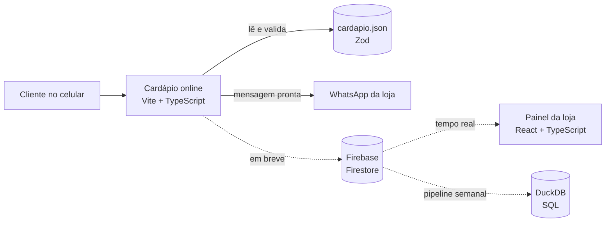

# 🧁 Docelice — Sistema de encomendas

[](https://github.com/amfpdev-coder/docelice-sistema-encomendas/actions/workflows/ci.yml)


Sistema de encomendas da **Docelice**, confeitaria artesanal de João Pessoa/PB.
A cliente monta o pedido de docinhos e tortas num cardápio online e ele chega pronto
no WhatsApp da loja. Em seguida, o pedido passa a ser salvo e a dona acompanha tudo
num painel em tempo real.

🔗 **No ar:** [docelice.netlify.app](https://docelice.netlify.app)

---

## O problema

A Docelice trabalha só com encomendas e recebia os pedidos por mensagens soltas no
WhatsApp. Isso gerava idas e vindas para confirmar sabores, quantidades, cor da forminha,
tamanho da torta e valor do sinal.

## A solução

- **Cardápio online:** a cliente escolhe docinhos (de 25 em 25, mínimo de 50) e tortas
  (tamanho, massa, 2 recheios e acabamento) com o preço calculado na hora.
- **Pedido pronto no WhatsApp:** uma mensagem organizada com itens, retirada, total,
  sinal de 50% e restante.
- **Painel da loja** _(em breve)_: pedidos em tempo real, status, agenda de produção
  e comanda para imprimir.
- **Pipeline de dados** _(em breve)_: métricas de vendas com dados anonimizados.

> **Princípio de projeto:** o WhatsApp é sempre o caminho garantido. Se salvar o pedido
> no banco falhar, o WhatsApp abre do mesmo jeito, e nenhuma venda se perde.

## Arquitetura



## Stack

| Camada            | Ferramentas                                          |
| ----------------- | ---------------------------------------------------- |
| Front (cardápio)  | Vite, TypeScript (strict), CSS — sem framework       |
| Contrato de dados | Zod                                                  |
| Qualidade         | Vitest, ESLint, Prettier, GitHub Actions (CI)        |
| Hospedagem        | Netlify (deploy automático a cada push)              |
| Em breve          | Firebase, React no painel, Python + DuckDB nos dados |

## Decisões técnicas

- **Valores em centavos (inteiros):** evitam erros de arredondamento de ponto flutuante
  (`0,1 + 0,2 ≠ 0,3` em JavaScript).
- **Contrato de dados com Zod:** o `cardapio.json` é validado ao carregar. Um preço
  digitado errado gera uma mensagem clara, em vez de quebrar a página. Os tipos do
  TypeScript são gerados a partir dos esquemas (`z.infer`).
- **Regras de negócio separadas da tela:** `src/dominio/` não mexe no HTML, então é
  fácil de testar.
- **TypeScript 6.0:** o ecossistema de lint (typescript-eslint) ainda não suporta o
  TypeScript 7.

## Como rodar

Pré-requisito: Node 22.

```bash
npm install
npm run dev        # servidor local em http://localhost:5173
```

| Comando             | O que faz                                 |
| ------------------- | ----------------------------------------- |
| `npm run dev`       | servidor local com atualização automática |
| `npm test`          | roda os testes (Vitest)                   |
| `npm run typecheck` | confere os tipos (TypeScript)             |
| `npm run lint`      | procura problemas no código (ESLint)      |
| `npm run format`    | formata o código (Prettier)               |
| `npm run build`     | gera a versão otimizada na pasta `dist/`  |

## Estrutura

```
public/
  cardapio.json        produtos, preços e regras (editável sem mexer no código)
  img/                 logo e fotos
src/
  dominio/             regras de negócio: dinheiro, pedido, contrato do cardápio
  servicos/            comunicação com o mundo de fora (carregar o cardápio)
  main.ts              ponto de entrada
tests/                 testes das regras de negócio e do contrato de dados
```

## Roteiro

- [x] **Fase 0** — fundação: Vite + TypeScript strict, qualidade, CI e deploy
- [ ] **Fase 1** — cardápio completo: montadores, pedido, mensagem, comanda para imprimir
- [ ] **Fase 2** — sistema: Firebase, painel da loja em React, status em tempo real
- [ ] **Fase 2.5** — dados: pipeline com Python + DuckDB, métricas e dados sintéticos
- [ ] **Fase 3** — lançamento

---

Feito por **[amfp.dev](https://amfp.dev)** · projeto voluntário para a Docelice ([@docelicejp](https://instagram.com/docelicejp))
